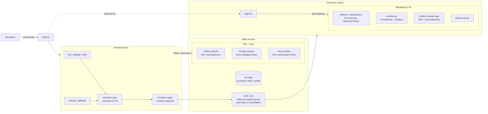

# AWS EKS Platform: Terraform + GitOps + DevSecOps

[](https://github.com/EttoreCSenatore/aws-eks-platform/actions/workflows/terraform.yml)

A production-style Kubernetes platform on AWS, built end to end with Infrastructure as Code.
One `git push` plans the change, scans it for security issues, posts the plan on the pull request,
and (after a human approves) applies it. Inside the cluster, ArgoCD keeps every workload in sync with Git.

**Stack:** Terraform · AWS (VPC, EKS, IAM, KMS, S3, CloudWatch) · GitHub Actions with OIDC · ArgoCD · Helm ·
Prometheus · Grafana · Checkov · TFLint · Gitleaks

---

## Architecture



## What this demonstrates

| Area | Implementation |
|---|---|
| **Infrastructure as Code** | Two Terraform stacks: `bootstrap/` (one-time state bucket + CI identity) and `infra/` (VPC, EKS, GitOps). Versions pinned, provider lock file committed. |
| **Networking** | 3-AZ VPC with public, private and isolated "intra" subnets. Nodes run in private subnets only. VPC Flow Logs to CloudWatch. |
| **Kubernetes** | EKS with managed node group (Spot, several instance types), EKS-managed add-ons (VPC CNI, CoreDNS, kube-proxy, Pod Identity agent), access entries instead of the legacy `aws-auth` ConfigMap. |
| **CI/CD** | GitHub Actions: lint and security scan on every PR, `terraform plan` posted as a PR comment, `apply` only on `main` and only after reviewer approval in a protected environment. |
| **Keyless auth** | GitHub OIDC → AWS. No access keys stored anywhere. Separate **read-only plan role** (PRs) and **apply role** (only reachable from the approved environment). |
| **GitOps** | Terraform installs only ArgoCD and a root app. Everything else in the cluster is declared in [`gitops/`](gitops/) and reconciled automatically (self-heal + prune). |
| **Security (shift left)** | Checkov (Terraform, Kubernetes, Actions) with results in the GitHub Security tab, Gitleaks secret scanning, TFLint with the AWS ruleset, all actions pinned to commit SHAs, Dependabot updates. |
| **Runtime security** | Kubernetes secrets encrypted with KMS, IMDSv2 enforced with hop limit 1 (pods can't steal node credentials), `restricted` Pod Security Standard, default-deny NetworkPolicies enforced by the VPC CNI, API/audit/authenticator logs to CloudWatch. |
| **Observability** | kube-prometheus-stack (Prometheus, Alertmanager, Grafana, exporters) and metrics-server; the sample app autoscales on CPU and is scraped via a ServiceMonitor. |
| **Cost control** | Spot nodes, single NAT gateway in dev, log retention limits, one-click `destroy` workflow. |

Every accepted security finding is listed with its reason in [`.checkov.yaml`](.checkov.yaml).

## Repository layout

```
bootstrap/          one-time: S3 state bucket, GitHub OIDC provider, plan/apply IAM roles
infra/
  main.tf           VPC + EKS
  gitops.tf         ArgoCD + root application
  values/           Helm values
  envs/dev.tfvars   per-environment settings
gitops/
  apps/             ArgoCD Applications (app-of-apps), ordered with sync waves
  platform/         namespaces, Pod Security labels, NetworkPolicies
.github/workflows/  terraform.yml (lint → scan → plan → apply), destroy.yml
```

## Run it yourself

### Prerequisites

Terraform ≥ 1.10, AWS CLI v2 logged in to your account, `kubectl`. Optional: `tflint`, `checkov`.

### 1. Bootstrap (once per AWS account)

```bash
make bootstrap        # creates the state bucket and the two CI roles
terraform -chdir=bootstrap output
```

### 2. Deploy

```bash
cp infra/backend.hcl.example infra/backend.hcl   # put the state_bucket output in it
make init
make plan
make apply            # about 15–20 minutes
make kubeconfig
kubectl get nodes
```

### 3. Look around

```bash
make argocd           # ArgoCD UI on https://localhost:8080 (user: admin)
make grafana          # Grafana on http://localhost:3000 (user: admin)
kubectl -n demo get pods,hpa,networkpolicy
```

### 4. Connect GitHub to AWS (optional, enables the pipeline)

1. In **Settings → Environments**, create `production` and add yourself as a required reviewer.
2. In **Settings → Secrets and variables → Actions → Variables**, add:
   - `TF_STATE_BUCKET` = `state_bucket` output
   - `AWS_PLAN_ROLE_ARN` = `plan_role_arn` output
   - `AWS_APPLY_ROLE_ARN` = `apply_role_arn` output
3. Open a pull request: the plan appears as a comment. Merge it: the apply waits for your approval.

Until these variables exist, the pipeline still runs lint and security scans and skips the AWS jobs.

### 5. Tear down

```bash
make destroy          # or run the "destroy" workflow and type destroy-dev
```

The bootstrap bucket has `prevent_destroy` so state history is never lost by accident.

## Cost

Rough on-demand figures for `us-east-1` in the dev configuration (check the
[AWS Pricing Calculator](https://calculator.aws/) for current prices):

| Item | Approx. |
|---|---|
| EKS control plane | $0.10 / hour |
| NAT gateway (1) | ~$0.045 / hour + data |
| 2 × Spot `*.large` nodes | ~$0.05–0.08 / hour |
| KMS key, CloudWatch logs, EBS | a few dollars / month |
| **Total** | **≈ $0.20–0.25 / hour (≈ $150 / month if left running)** |

A few hours of testing costs about a dollar. Destroy when you're done.

## Design decisions

- **Two stacks.** The state bucket and CI roles must exist before remote state does, and they change rarely. Keeping them apart limits the blast radius of everyday changes.
- **S3 native state locking** (`use_lockfile`) instead of a DynamoDB table: one fewer resource, supported since Terraform 1.10.
- **Community modules** (`terraform-aws-modules/vpc`, `/eks`) for the heavy lifting: well-reviewed and widely used; this repo focuses on how they are composed and secured.
- **Terraform stops at ArgoCD.** Terraform is good at cloud resources; Git-driven reconciliation is better for what runs inside the cluster. Drift inside the cluster is reverted automatically.
- **Intra subnets for the control plane.** EKS control plane network interfaces sit in subnets with no internet route.

## Roadmap

- Karpenter for faster, cheaper node scaling
- AWS Load Balancer Controller + ExternalDNS + cert-manager for public ingress with TLS
- External Secrets Operator backed by AWS Secrets Manager
- Kyverno policies (signed images, required labels) and Trivy Operator for in-cluster scanning
- Separate `staging`/`prod` environments with promotion between them

## License

MIT, see [LICENSE](LICENSE).
